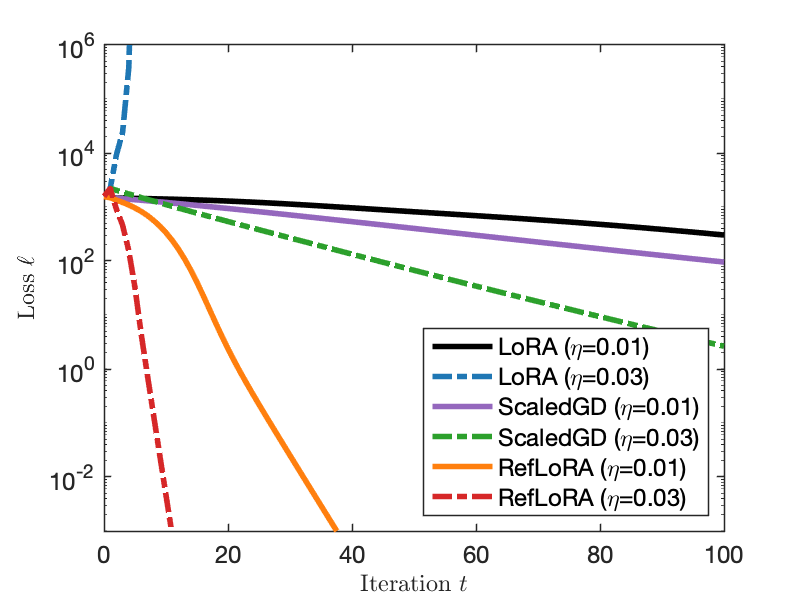
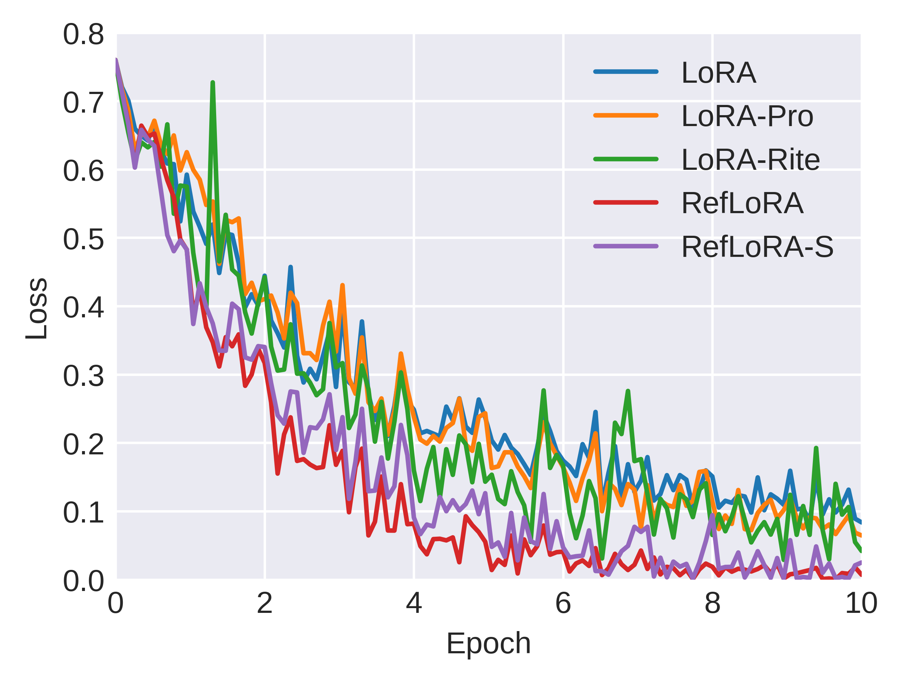
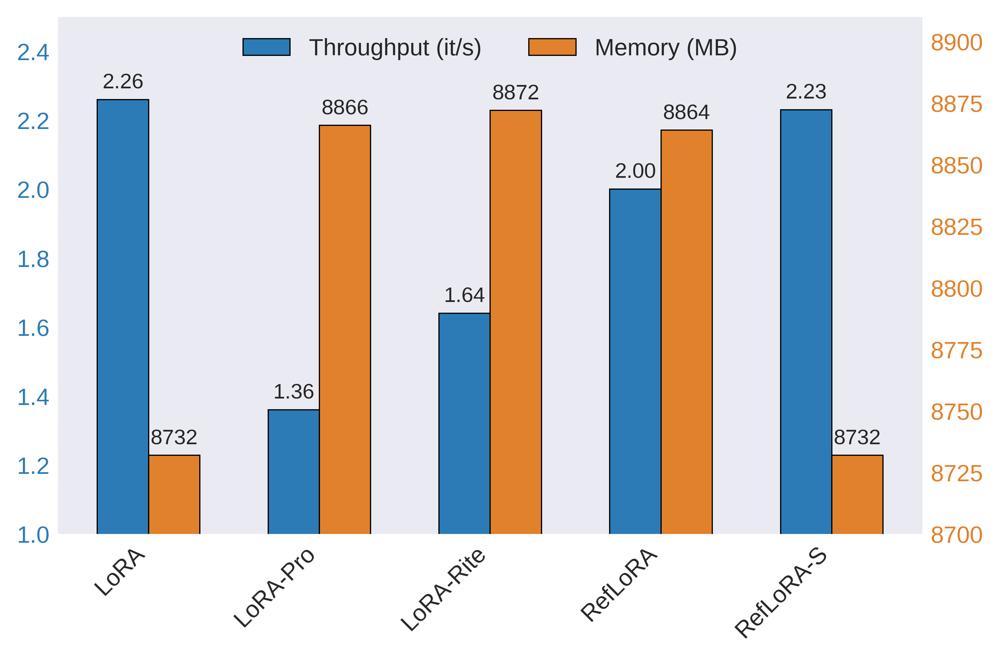
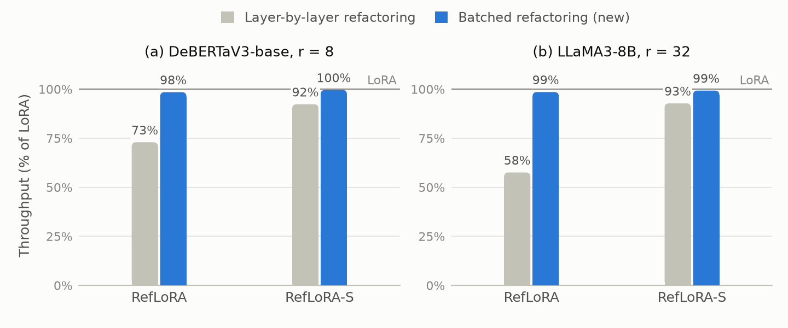
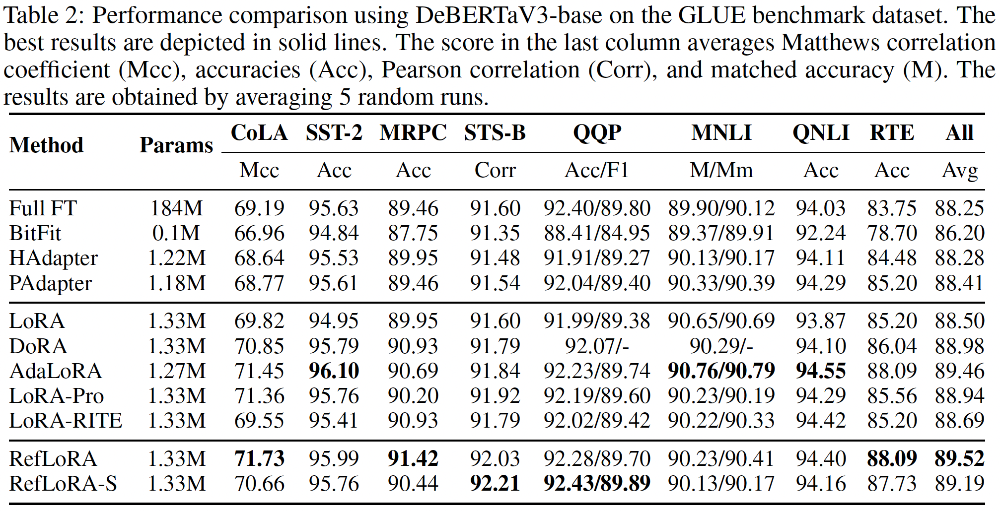
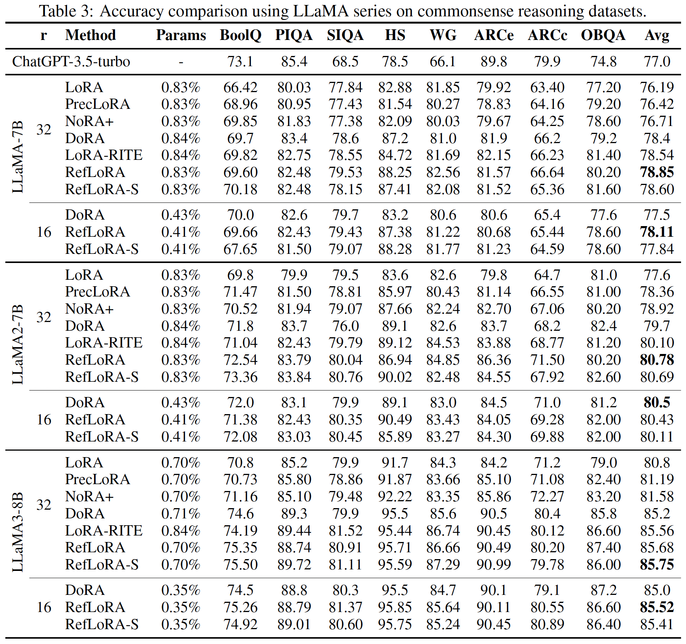

# [NeurIPS 2025] RefLoRA
[](https://papers.nips.cc/paper_files/paper/2025/hash/85c1ee0b3cdf49b84f14b163b01f2711-Abstract-Conference.html)
[](https://doi.org/10.52202/085713-3106)

This repository provides codes for reproducing the results in our NeurIPS 2025 paper [RefLoRA: Refactored Low-Rank Adaptation for Efficient Fine-Tuning of Large Models](https://papers.nips.cc/paper_files/paper/2025/file/85c1ee0b3cdf49b84f14b163b01f2711-Paper-Conference.pdf). 

## Overview

This paper deals with the non-unique factorization challenge in low-rank adaptation (LoRA), which leads to inconsistent updates, unbalanced weights, and slow convergence. Specifically, for equivalent low-rank factorizations $\mathbf{A} \mathbf{B}^\top = \tilde{\mathbf{A}}\tilde{\mathbf{B}}^\top$, the resultant weight increment can differ remarkably; see analysis in our paper. 

**Key idea:** RefLoRA identifies the *optimal factorization* that minimizes the loss upper bound. We prove that this solution admits a closed-form expression, resulting in flatter loss landscape that facilitates stable and efficient optimization. 

With the optimal refactoring, RefLoRA guarantees consistent and balanced weight updates, as well as faster empirical convergence. A simplified variant termed RefLoRA-S is developed to further reduce the overhead.

<p float="left">
    
    
    
</p>

**New implementation.** RefLoRA and RefLoRA-S now fine-tune *as fast as LoRA* (98.5–99.6% of its throughput) with the same peak GPU memory. Unlike the implementation in our paper (figures above), which refactors the LoRA layers one by one, the new implementation batches the refactoring of all layers (`batched=True`), with the same results up to floating-point round-off.

<picture>
  <source media="(prefers-color-scheme: dark)" srcset="assets/throughput-dark.png">
  
</picture>


## Experiments
### Setup

Our codes are tested with python 3.12. Install the RefLoRA package in editable mode, together with the dependencies of the experiments:

```bash
pip install -e ".[experiments]"
```

Use `pip install -e ".[paper]"` instead to reproduce the exact package versions of the paper. The core package alone (`pip install -e .`) only depends on `torch`, `peft`, and `transformers`.

To run the tests (CPU is enough), which also check that the implementation matches the one used in the paper:

```bash
pip install -e ".[test]"
pytest
```

Next, download the commonsense reasoning datasets from [LLM-Adapters](https://github.com/AGI-Edgerunners/LLM-Adapters), and prepare them as
```bash
commonsense_reasoning/
├── dataset/
│   ├── ARC-Challenge/
│   ├── ARC-Easy/
│   ├── boolq/
│   ├── hellaswag/
│   ├── openbookqa/
│   ├── piqa/
│   ├── social_i_qa/
│   └── winogrande/
└── ft-training_set/
    └── commonsense_170k.json

```

### General usage
RefLoRA combines seamlessly with Hugging Face’s `Trainer` class via just three lines of modification, replacing `Trainer` with `RefTrainer`. Set `use_scalar=True` to use RefLoRA-S. 
```python
from reflora import Refactorer, RefTrainer

refactorer = Refactorer(model, use_scalar=False, warmup_steps=100)
trainer = RefTrainer(*args, **kwargs, refactorer=refactorer)
```

Alternatively, it can be directly integrated into a `torch.optim.Optimizer` via

```python
from reflora import Refactorer

refactorer = Refactorer(model, use_scalar=False, warmup_steps=100)
refactorer.integrate_into_optimizer(optimizer)
```

#### Arguments of `Refactorer`

| Argument | Default | Description |
| --- | --- | --- |
| `model` | — | A `PeftModel`/`LoraModel`, or any module containing PEFT LoRA layers. |
| `warmup_steps` | `0` | Number of optimizer steps run as vanilla LoRA before refactoring starts. |
| `re_init` | `False` | Randomly re-initialize both LoRA factors and subtract their product from the frozen pre-trained weight, so that the model is unchanged but both factors are full rank. |
| `interval` | `1` | Refactor every `interval` optimizer steps after warmup. |
| `use_scalar` | `False` | Use the lightweight RefLoRA-S. |
| `batched` | `True` | Batch the refactoring of all layers (`True`) or refactor them layer by layer (`False`); the former is much faster on GPUs. |

> [!NOTE]
> RefLoRA assumes full-rank LoRA factors (Assumption 1), whereas PEFT initializes `lora_B = 0` by default. Use `warmup_steps > 0` (e.g., 100 as in our scripts) or `re_init=True`. Otherwise, layers with a zero factor fall back to vanilla LoRA until both factors become nonzero.

#### Supported features

- **LoRA layers:** Linear (including 8-bit/4-bit quantized base layers) and Embedding. Convolutional LoRA layers are not supported.
- **Optimizers:** RefLoRA preconditions the gradients, and thus works with any `torch.optim.Optimizer`. RefLoRA-S refactors the weights and rescales the optimizer moments accordingly, which supports Adam/AdamW (including AMSGrad) and SGD.
- **Precision:** fp32, bf16, and fp16 LoRA weights; the $r \times r$ computations always run in at least fp32.
- **Training:** single-GPU and DDP training (as in our scripts). `RefTrainer` keeps the refactoring schedule when resuming from a checkpoint. FSDP and DeepSpeed are not supported.

### Natural language understanding




The following commands are used to reproduce the results for the GLUE benchmark. Hyperparameters are offered in Table 7 of Appendix D.6. 

```bash
cd NLU
bash debertaV3-base.sh
```

The script contains the setup for CoLA, while for other tasks, set `TASK_NAME` and the hyperparameters (learning rate, epochs, warmup steps, max sequence length, classifier dropout, and weight decay) according to Table 7. Use `--use_scalar True` for RefLoRA-S.

### Commonsense reasoning



To reproduce results on commonsense reasoning datasets:

```bash
cd commonsense_reasoning
bash scripts/llama_7B.sh
bash scripts/llama2_7B.sh
bash scripts/llama3_8B.sh
```

Each script fine-tunes the model with RefLoRA and then evaluates it on all 8 datasets. Add `--use_scalar` to the fine-tuning command for RefLoRA-S.

## Credits
Our implementation builds upon the following repositories:

- https://github.com/AGI-Edgerunners/LLM-Adapters
- https://github.com/NVlabs/DoRA

## Citation
If you find this work useful, please consider citing:
> Y. Zhang, B. Li, and G. B. Giannakis, “RefLoRA: Refactored Low-Rank Adaptation for Efficient Fine-Tuning of Large Models,” in *Proceedings of Advances in Neural Information Processing Systems (NeurIPS)*, 2025. 

```tex
@inproceedings{RefLoRA,
 title = {RefLoRA: Refactored Low-Rank Adaptation for Efficient Fine-Tuning of Large Models},
 author = {Zhang, Yilang and Li, Bingcong and Giannakis, Georgios},
 booktitle = {Advances in Neural Information Processing Systems},
 doi = {10.52202/085713-3106},
 pages = {92847--92878},
 volume = {38},
 year = {2025}
}

```
